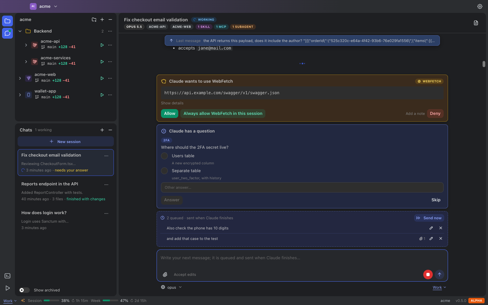
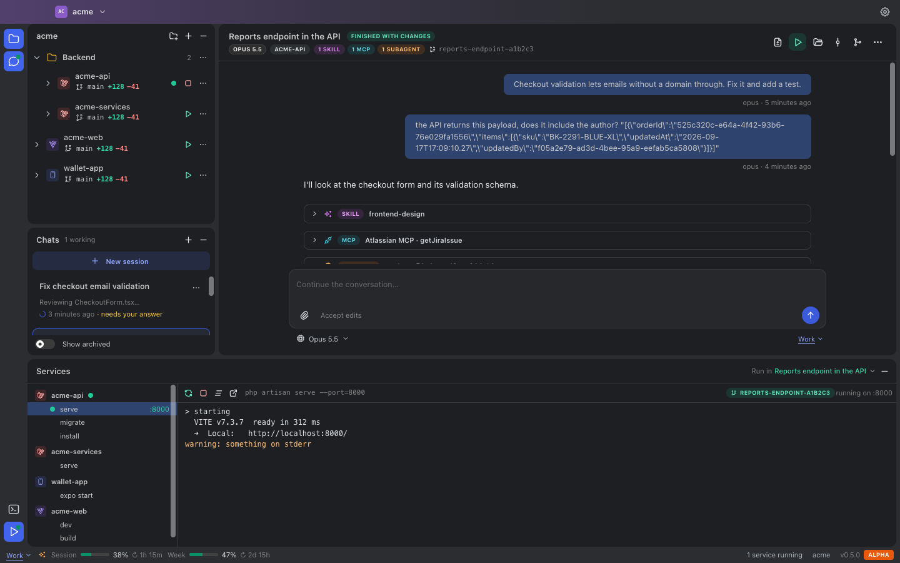
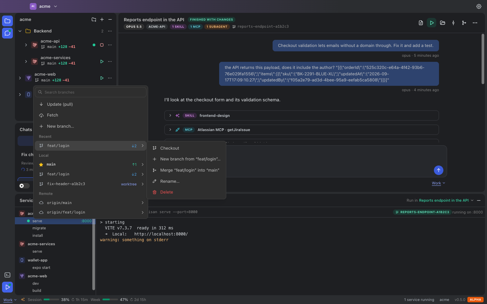
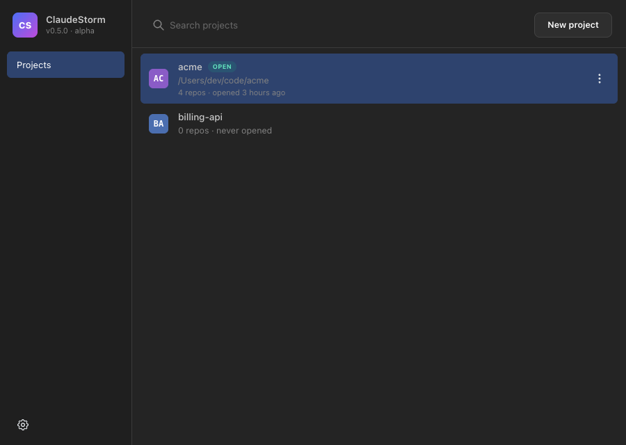

<div align="center">

# ⚡ ClaudeStorm

**A desktop console for running many Claude Code sessions in parallel, across all the repos of a project.**

Chat with Claude, let it work in isolated git worktrees, run your dev servers, review diffs, approve what it wants to do, and merge, all from one window that feels like a JetBrains IDE.


[](LICENSE)



</div>

---

## Why ClaudeStorm?

[Claude Code](https://docs.anthropic.com/en/docs/claude-code) is great in a terminal, but juggling several tasks at once gets messy fast: which terminal was doing what, which branch has which change, is the dev server running the right code, did Claude stop because it is waiting for me?

ClaudeStorm wraps the official `claude` CLI in a workspace built for **parallel work**:

- 🧵 **Many sessions, one window.** Every chat is a Claude Code session. Run several at once (you choose the limit), and the rest wait in line.
- 🌳 **Isolated git worktrees.** A session can work on its own branch and folder, so two Claudes never step on each other or on you.
- ▶️ **Your servers, where the code is.** Run `npm run dev`, `php artisan serve` and friends from the main checkout or from a session's worktree, with one click.
- ✅ **Nothing happens behind your back.** Permission prompts and Claude's multiple-choice questions show up as cards you answer in the UI.
- 🔔 **It tells you when it is your turn.** Desktop notifications, a Dock badge and a sticky "last message" bar so you never lose track.

It runs **locally**, uses **your own Claude Code login** (subscription or API key), and never sees your credentials.

## Features

### Sessions and chat
- **Parallel Claude Code sessions** per project, with a configurable concurrency limit and a queue.
- **Direct or isolated mode.** Direct sessions edit your repos in place; isolated sessions get one git worktree and branch per repo.
- **Queued messages, like Claude Code.** Keep typing while Claude works: messages queue up and go out together when the turn ends. **Send now** interrupts the turn and sends them immediately, without losing the conversation.
- **Approvals and questions.** Tool permissions arrive as cards with **Allow**, **Always allow in this session** and **Deny** (with an optional note for Claude). `AskUserQuestion` prompts appear as radio buttons or checkboxes, plus an "other answer" field.
- **See what Claude used.** Skills, MCP tools, subagents and web tools are tagged in the chat and summarized in the session header.
- **Sticky last prompt.** A bar pins your latest message once it scrolls away. Click it to jump back; click again to go to the one before.
- **Attachments.** Drag and drop files, pick them, or paste screenshots and files from the clipboard.
- **Per-message model picker** that follows message → session → account → global default.
- **Desktop notifications** when a session finishes, replies, fails or needs your answer, with sound and a Dock badge.

### Git
- **Live status per repo**: branch, `+added −removed` lines and ahead/behind, with details on hover.
- **WebStorm-style branches popup**: search, recent/local/remote branches, checkout, new branch from any ref, merge into current, rename, delete, fetch and pull.
- **Session branches**: diff against the base branch, commit, merge back, or delete the worktree (keeping or dropping the branch).
- Branches created by ClaudeStorm are named after the task (`fix-login-validation-a1b2c3`), never after the tool.

### Running your code
- **Services panel** with every repo command (framework detection fills them in: Next.js, Vite, React, Expo, Laravel, Node…), live logs, port detection and "open in browser".
- **Run in a session's worktree** with one click, or from the banner that appears when Claude finishes a change.
- **Worktrees come ready to run**: `.env*` files are copied and `node_modules`/`vendor` are cloned with copy-on-write (APFS), so a new worktree starts in seconds without a reinstall.
- **Integrated terminal** (xterm.js) with tabs, opened at any repo or worktree.
- **Open in your editor** (WebStorm by default; configurable).

### Claude can test its own work (MCP)
Every session gets a built-in, local **ClaudeStorm MCP server** with tools to list the project's services, start/restart/stop the ones it owns, read their logs and inspect its worktree. So Claude can restart the dev server after a change and confirm it compiles, instead of guessing. Services Claude starts are labeled in the UI, and it can never stop the ones you started.

### Everything else
- **Multiple Claude accounts**: isolated subscription profiles (Claude Code does the login in your browser), API keys stored in the OS keychain, or the login already on your machine.
- **Plan usage in the status bar** (session and weekly limits, with reset times).
- **Islands layout**: resizable, minimizable tool windows; each project window remembers its layout.
- **Multi-language UI**: follows your system language, falls back to English, and can be changed in Settings.

## Screenshots

| Run services inside a session's worktree | Branches popup |
| --- | --- |
|  |  |

<p align="center"></p>

## Getting started

### Requirements

- **macOS** (tested on Apple Silicon). Linux and Windows code paths exist but are not tested yet.
- **[Claude Code](https://docs.anthropic.com/en/docs/claude-code)** installed and on your `PATH` (`claude --version` should work).
- To build from source: **Node.js 20+** and **Rust** (stable) with the [Tauri 2 prerequisites](https://tauri.app/start/prerequisites/).

### Install a release

Download the latest `.dmg` from the [Releases page](https://github.com/everhdezz/claude-storm/releases/latest), open it and drag **ClaudeStorm** into Applications.

> The alpha builds are not signed or notarized yet. The first time, right-click the app → **Open**, or allow it in **System Settings → Privacy & Security**.

### Build from source

```bash
git clone https://github.com/everhdezz/claude-storm.git
cd claude-storm
npm install

# Run the desktop app in development
npm run tauri dev

# Build the app bundle and installer (src-tauri/target/release/bundle/)
npm run tauri build
```

### First steps

1. **Create a project** and add the repos you work with (several repos per project is the sweet spot).
2. **Pick a Claude account** in the status bar or in Settings → Claude accounts.
3. **Write in “Chat with AI”.** A new session starts; if another one is already working, it runs isolated in its own worktree.
4. Answer approval cards when they show up, queue follow-ups while Claude works, and run your servers from the Services panel or the "start the server" banner.

## How it works

```
┌──────────────────────── ClaudeStorm (Tauri) ─────────────────────────┐
│  React UI (Mantine)  ◀── events ──  Rust core                         │
│                                      ├─ Session manager ── claude -p  │──▶ Claude Code CLI
│                                      │    (stream-json, --resume)     │      (your login)
│                                      ├─ Git + worktrees               │
│                                      ├─ Process manager (services)    │
│                                      ├─ PTY terminals                 │
│                                      └─ Local MCP server (127.0.0.1) ◀┼── tools + permission
└───────────────────────────────────────────────────────────────────────┘    prompts from Claude
```

- Each prompt runs `claude -p --output-format stream-json`, resuming the session's conversation; the stream is turned into chat items as it arrives.
- Isolated sessions get `git worktree add -b <task-branch>` per repo, prepared with your env files and cloned dependencies.
- ClaudeStorm passes Claude Code an MCP config pointing at its own local server (a random port on `127.0.0.1` and a secret URL per session), plus `--permission-prompt-tool`, so permission prompts and questions come back to the UI.
- App data (projects, sessions, chat history) lives in the OS app data folder (`~/Library/Application Support/dev.claudestorm.app` on macOS).

## Privacy and security

- **Your credentials stay with Claude Code.** Subscription logins happen inside Claude Code in isolated profile folders; ClaudeStorm only relays the login URL. API keys go to the OS keychain.
- **Everything is local.** No telemetry, no accounts, no servers of our own. The only network traffic is what Claude Code itself does.
- **The MCP server only listens on 127.0.0.1**, with an unguessable URL per session, and only exposes this project's services.
- **Claude only does what you allow.** Prompts Claude Code would ask about in a terminal are shown to you; "always allow" applies to the current session only.

## Contributing

Contributions are very welcome: bug reports, ideas, code and especially **translations**.

```bash
npm run dev         # UI in the browser with mocked data (no Tauri, no Claude needed)
npm run typecheck   # TypeScript
npm run i18n:check  # missing or unused translations
cd src-tauri && cargo test --lib   # Rust tests
```

`npm run dev` serves the UI at `http://localhost:1420` with a mock backend (`src/dev/mockIpc.ts`), which is the fastest way to work on the interface. Add `?window=project-p1#/project/p1` to open a project window.

Some Rust tests talk to the real Claude Code CLI and cost a few cents of Haiku; they are ignored by default:

```bash
cargo test --lib -- --ignored --nocapture   # session, MCP, queue and approvals end-to-end
```

### Project layout

```
src/                  React + TypeScript UI
  features/           sessions, projects, git branches, services, settings…
  i18n/               t()/tn() helpers and locale catalogs
src-tauri/src/        Rust core
  sessions/           Claude Code runner, stream parser, worktrees, worktree prep
  mcp/                local MCP server and its tools
  commands/           Tauri commands called by the UI
scripts/              dev tooling (i18n checker)
```

### Translating ClaudeStorm

The UI is written in English, and the English text is the translation key:

```ts
t("New session")                                     // → "Nueva sesión"
t("Open in {editor}", { editor: "WebStorm" })        // placeholders keep their {name}
tn(count, "{count} file", "{count} files")           // singular / plural
```

To add a language:

1. Copy `src/i18n/locales/es.ts` to `src/i18n/locales/<code>.ts` (for example `fr.ts`) and translate the values, keeping every `{placeholder}`.
2. Register it in `src/i18n/index.ts` (add it to `LOCALES` and `CATALOGS`).
3. Run `npm run i18n:check`; it lists anything missing.
4. A handful of backend messages (chat notices, login errors) live in `src-tauri/src/i18n.rs`.

## Roadmap

- [ ] Signed and notarized macOS builds, auto-updates
- [ ] Linux and Windows testing
- [ ] Per-worktree ports so the main checkout and a session can run side by side
- [ ] Configurable files to copy into worktrees (beyond `.env*`)
- [ ] More languages (help wanted!)

## License

ClaudeStorm is licensed under the [Apache License 2.0](LICENSE).
Copyright 2026 Ever Hernandez ([@everhdezz](https://github.com/everhdezz)). See [NOTICE](NOTICE).

The ClaudeStorm name and logo are not covered by the license (Apache-2.0, section 6).

## Disclaimer

ClaudeStorm is an independent, community project. It is **not affiliated with, endorsed by or sponsored by Anthropic**. "Claude" and "Claude Code" are trademarks of Anthropic, PBC. ClaudeStorm drives the official Claude Code CLI that you install and log into yourself, and your usage is subject to Anthropic's terms.
